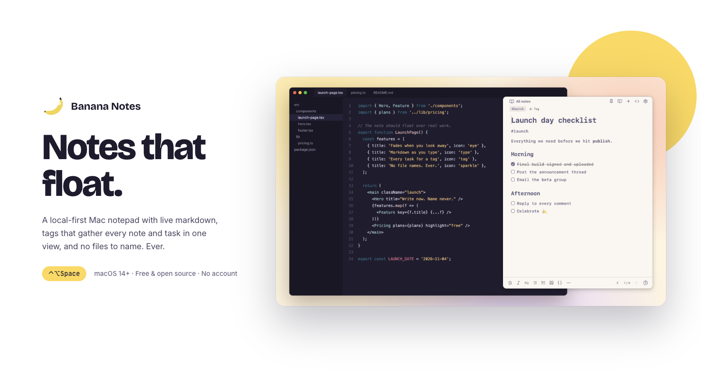
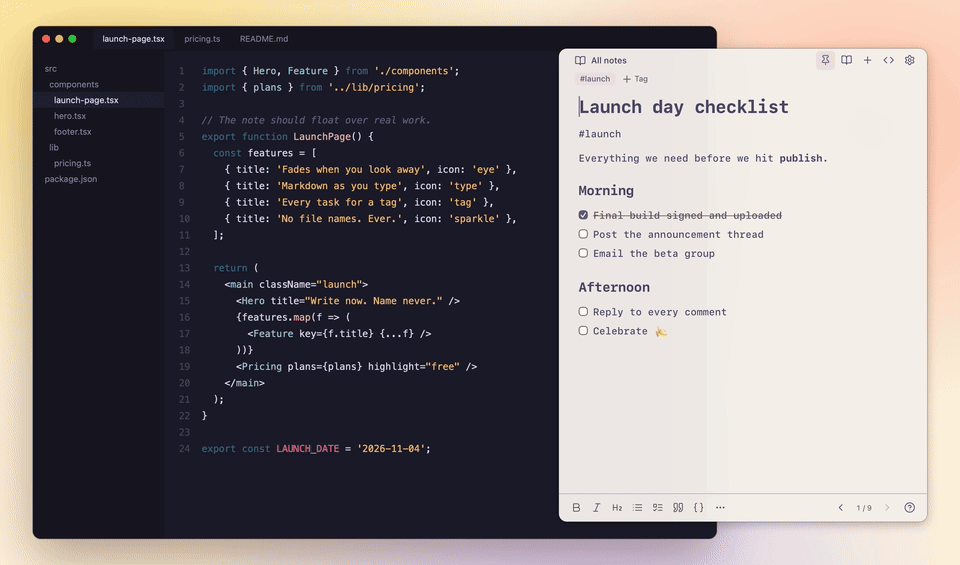
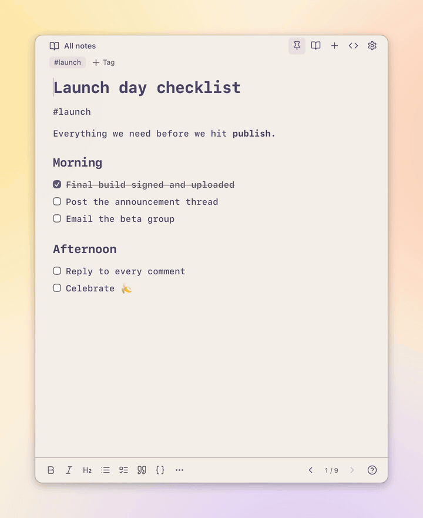
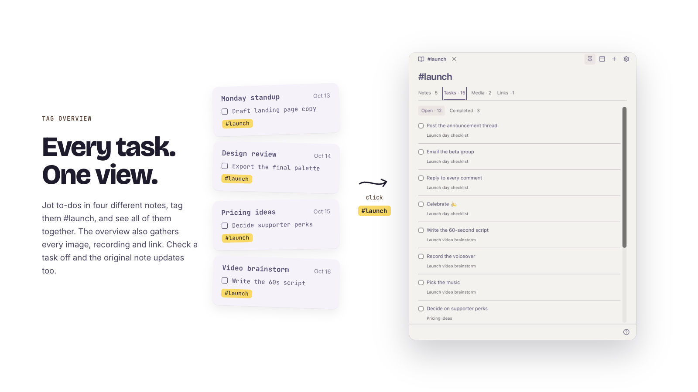
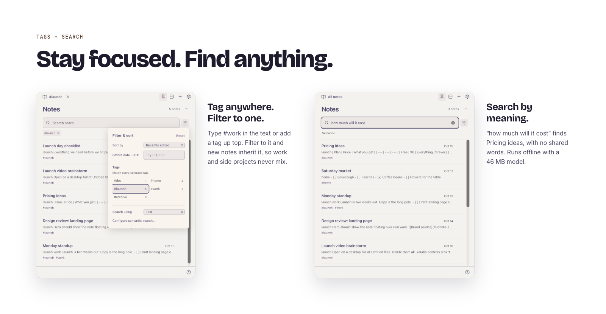
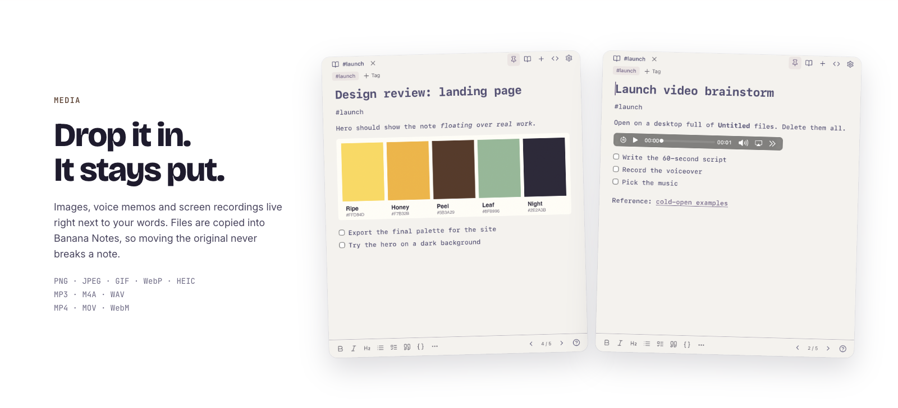
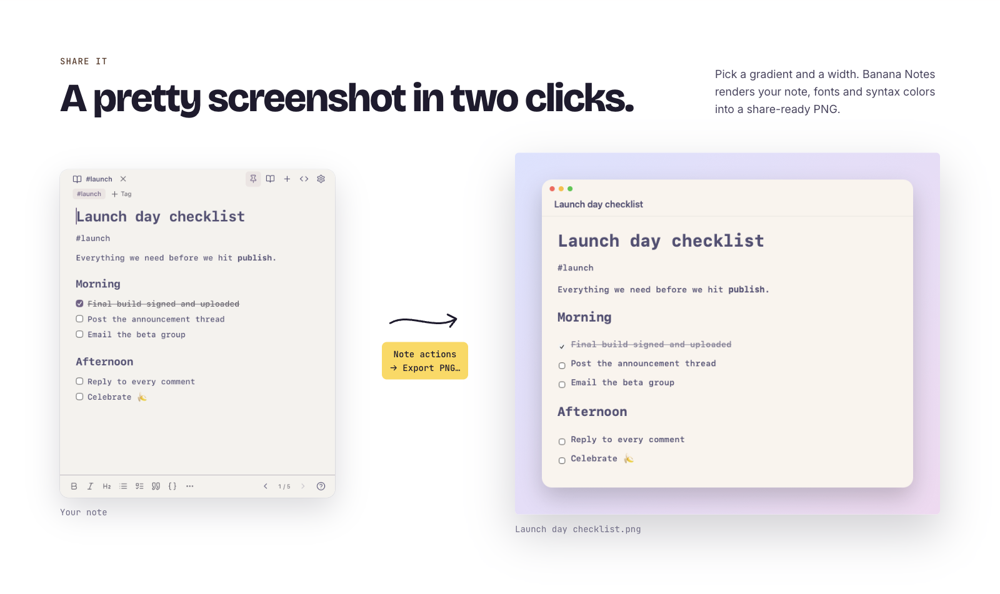
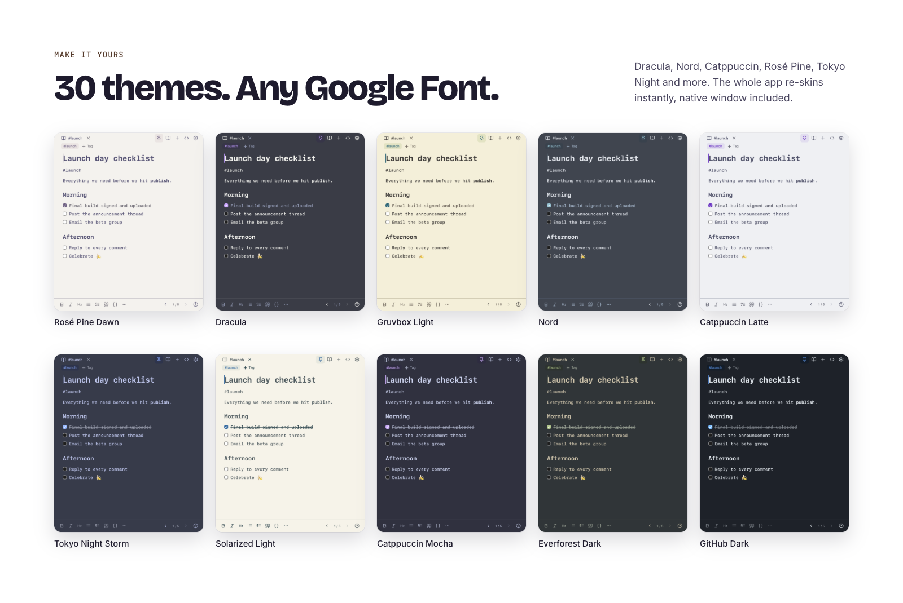

<p align="center">
  <picture>
    <source media="(prefers-color-scheme: dark)" srcset="assets/brand/logo-dark.svg">
    
  </picture>
</p>

<p align="center">
  
</p>

<p align="center">
  
  
  
  
</p>

<p align="center">
  <a href="#download"><strong>Download</strong></a> ·
  <a href="#feature-tour"><strong>Feature tour</strong></a> ·
  <a href="#keyboard-shortcuts"><strong>Shortcuts</strong></a> ·
  <a href="#faq"><strong>FAQ</strong></a> ·
  <a href="#reference"><strong>Reference</strong></a>
</p>

**Banana Notes is a tiny floating notepad for your Mac.** It sits over whatever you're doing, fades when you look away, and comes back with one shortcut. Markdown renders as you type, notes save themselves, and tags pull every note, task and file for a topic into one view. No account, no cloud, no files to name.

<p align="center">

https://github.com/user-attachments/assets/c5dfa4db-5e3d-41b5-93e6-eabe29bb2bad

</p>

## At a glance

<table>
  <tr>
    <td width="33%" valign="top"><a href="#focus-fade"><strong>Floats over your work</strong></a><br>Solid while you write, see-through when you click away.</td>
    <td width="33%" valign="top"><a href="#tag-overview"><strong>Every task, one view</strong></a><br>Tag notes <code>#launch</code>, click the tag, see it all.</td>
    <td width="33%" valign="top"><a href="#live-markdown"><strong>Markdown as you type</strong></a><br>Type <code>#</code> for a title. It just renders.</td>
  </tr>
  <tr>
    <td valign="top"><a href="#no-file-names"><strong>No files to name</strong></a><br><kbd>⌘</kbd><kbd>N</kbd> and start typing. Goodbye, Untitled (429).</td>
    <td valign="top"><a href="#media"><strong>Media and pretty exports</strong></a><br>Drop in images, audio and video. Share any note as a PNG.</td>
    <td valign="top"><a href="#themes"><strong>Make it yours</strong></a><br>32 themes, six bundled fonts, on-device search.</td>
  </tr>
</table>

## Download

Download the latest signed, notarized universal macOS disk image from [GitHub Releases](https://github.com/jzlosman/banana-notes/releases). Open the DMG and drag **Banana Notes.app** to **Applications**. On first launch, macOS verifies the Developer ID signature and notarization; if it asks you to confirm, choose **Open**. Press the global shortcut anywhere to bring it up: new installs default to <kbd>⌃</kbd><kbd>⇧</kbd><kbd>Space</kbd>; installs with an existing library and no saved shortcut retain the legacy <kbd>⌃</kbd><kbd>⌥</kbd><kbd>Space</kbd> default.

## Build from source

You'll need macOS 14 or later, the Xcode command-line tools and Node 22+.

```sh
git clone https://github.com/jzlosman/banana-notes.git && cd banana-notes
npm ci --ignore-scripts
npm run build
open "build/Banana Notes.app"
```

## Feature tour

<a id="focus-fade"></a>
### Solid when you write. See-through when you don't.



Pin a note over your editor, browser or video call. When you click away, it fades so you can still see what's underneath; click back in and it's fully readable again. The format bar and footer hide while it's faded, so you only see your words.

> **Try it:** <kbd>⌘</kbd><kbd>,</kbd> → **Window** → set **Inactive window opacity** to about 40% and **Background translucency** to about 25%. Then click the pin at the top of the note.

<a id="tag-overview"></a>
### Every task. One view.



This is the big one. Tasks end up scattered across a week of notes; tags bring them back together:

1. **Jot tasks in any note.** A standup note, a call, a brainstorm. Wherever you are.
2. **Tag each note** by typing `#launch` anywhere in it, or by clicking **Tag** at the top.
3. **Click the tag.** Its overview gathers every **note, task, image, recording and link** that carries it.
4. **Check tasks off right there.** The original note updates too.

There's nothing to set up and nothing to file. Just tag your notes.



> **Try it:** add `#launch` to two notes, each with a `[ ] ` task, then click the **#launch** badge at the top of either note.

<a id="live-markdown"></a>
### Markdown as you type

![Typing # makes a title and [ ] makes a checkbox](docs/media/live-markdown.gif)

Type `# ` for a title, `[ ] ` for a checkbox, `**bold**`, `> quote` or three backticks for code. It renders in place, with no split preview. Prefer buttons? Use the format bar, or <kbd>⌘</kbd><kbd>B</kbd> and <kbd>⌘</kbd><kbd>I</kbd>. Press Return twice to leave a list. <kbd>⌘</kbd><kbd>⇧</kbd><kbd>M</kbd> shows the raw Markdown whenever you want it.

Headings, bold, italic, strikethrough, bullet, numbered and task lists, blockquotes, links, tables, and fenced code with syntax highlighting. Press <kbd>⌘</kbd><kbd>F</kbd> to find text in the current note; Return / Shift–Return or <kbd>⌘</kbd><kbd>G</kbd> / <kbd>⇧</kbd><kbd>⌘</kbd><kbd>G</kbd> moves through matches.

> **Try it:** start a new note and type `# Today`, then `[ ] ` and a task.

<a id="no-file-names"></a>
### No files. No names. No "Untitled (429)".

![⌘N for a new note, ⌘[ and ⌘] to flip between notes](docs/media/no-file-names.gif)

There's no save button and nothing to name. Press <kbd>⌘</kbd><kbd>N</kbd> and start typing; the first line becomes the title, and every keystroke is saved. If the newest note in the current notebook is still blank, it is reused instead of adding another empty note. Flip back through your day with <kbd>⌘</kbd><kbd>[</kbd> and <kbd>⌘</kbd><kbd>]</kbd>, like turning pages. Notes are numbered oldest-first: adding a note leaves earlier page numbers unchanged. Left moves to a lower number; right moves to a higher one.

> **Try it:** <kbd>⌘</kbd><kbd>N</kbd>, write one line, then <kbd>⌘</kbd><kbd>[</kbd> to step back to your previous note.

<a id="tags-and-search"></a>
### Stay focused. Find anything.



- **Tag anywhere.** Type `#work` in the text, click **Tag** at the top, or use frontmatter.
- **Filter to one tag.** New notes inherit it, and <kbd>⌘</kbd><kbd>[</kbd> / <kbd>⌘</kbd><kbd>]</kbd> stay inside it, so work and side projects never mix. Try one tag per project, per area of life, or per recurring meeting.
- **Search by meaning.** Local semantic search adds meaning-based matches alongside exact text results. Fresh Mac installs use the available macOS English embedding model; Ollama is an optional alternative ([setup](#semantic-search)).

> **Try it:** <kbd>⌘</kbd><kbd>P</kbd> and search for an idea in different words than you wrote it.

<a id="media"></a>
### Drop it in. It stays put.



Drag or paste images into a note, or use **Note actions (…) → Attach file…** for audio and video. Files are copied into Banana Notes, so moving or deleting the original never breaks the note.

### A pretty screenshot in two clicks



**Note actions (…) → Export PNG…** renders the note, with your font and syntax colors, onto a gradient with a Mac-style frame. Made for Slack, social posts and meeting recaps.

<a id="launch"></a>
### Always a keystroke away

| Open it with | |
| --- | --- |
| Global shortcut | <kbd>⌃</kbd><kbd>⇧</kbd><kbd>Space</kbd> shows or hides it from any app |
| Raycast or Spotlight | Type "Banana" |
| Menu bar | Click the banana icon |
| Deep links | `banananotes://new`, `banananotes://tag/work`, and [more](#deep-links) |

Pin it to keep it on screen while you switch apps, or unpin it so it tucks away as soon as you click elsewhere. <kbd>Esc</kbd> or <kbd>⌘</kbd><kbd>W</kbd> hides it; it keeps running for next time. No Dock icon, no <kbd>⌘</kbd><kbd>Tab</kbd> clutter. Set or reset the shortcut in **Settings → General → Global shortcut**; new installs default to <kbd>⌃</kbd><kbd>⇧</kbd><kbd>Space</kbd>, while installs with an existing library and no saved shortcut retain the legacy <kbd>⌃</kbd><kbd>⌥</kbd><kbd>Space</kbd> default. The app menu includes **About Banana Notes**; **Check for Updates…** is available in builds packaged with Sparkle.

<a id="themes"></a>
### 32 themes. Six bundled fonts.



Banana Light and Banana Dark, plus Dracula, Nord, Catppuccin, Rosé Pine, Tokyo Night, Gruvbox, Solarized, GitHub and more. Everything re-skins instantly, native window chrome included, and code blocks can have their own syntax theme. Six fonts ship with the app and work offline: Space Mono (the default), JetBrains Mono, Overpass Mono, Fira Code, Georgia and Avenir Next. Want something else? Type any Google Fonts name and click **Download and use**.

> **Try it:** <kbd>⌘</kbd><kbd>,</kbd> → **Themes**, then filter to light or dark.

## Keyboard shortcuts

The Help view shows your configured global shortcut; this table shows the new-install default. The labels and remaining shortcuts match the app's Help list.

| Action | Shortcut |
| --- | --- |
| Show / hide Banana Notes | <kbd>⌃</kbd><kbd>⇧</kbd><kbd>Space</kbd> |
| New note | <kbd>⌘</kbd><kbd>N</kbd> |
| Older / newer note | <kbd>⌘</kbd><kbd>[</kbd> / <kbd>⌘</kbd><kbd>]</kbd> |
| Alternate navigation | <kbd>⌘</kbd><kbd>⇧</kbd><kbd>←</kbd> / <kbd>⌘</kbd><kbd>⇧</kbd><kbd>→</kbd> |
| Show notes | <kbd>⌘</kbd><kbd>⇧</kbd><kbd>E</kbd> |
| Pin / unpin window | <kbd>⌘</kbd><kbd>⇧</kbd><kbd>P</kbd> |
| Find in note | <kbd>⌘</kbd><kbd>F</kbd> |
| Next / previous match | <kbd>Return</kbd> / <kbd>⇧</kbd><kbd>Return</kbd> · <kbd>⌘</kbd><kbd>G</kbd> / <kbd>⇧</kbd><kbd>⌘</kbd><kbd>G</kbd> |
| Find notes | <kbd>⌘</kbd><kbd>P</kbd> |
| Markdown source / frontmatter | <kbd>⌘</kbd><kbd>⇧</kbd><kbd>M</kbd> |
| Settings | <kbd>⌘</kbd><kbd>,</kbd> |
| Hide window | <kbd>Esc</kbd> |
| Bold / italic | <kbd>⌘</kbd><kbd>B</kbd> / <kbd>⌘</kbd><kbd>I</kbd> |
| Add / edit link | <kbd>⌘</kbd><kbd>K</kbd> |
| Bigger / smaller note text | <kbd>⌘</kbd><kbd>+</kbd> / <kbd>⌘</kbd><kbd>−</kbd> |
| Reset note text size | <kbd>⌘</kbd><kbd>0</kbd> |
| Copy selected text | <kbd>⌘</kbd><kbd>C</kbd> |
| Copy formatted text | <kbd>⌘</kbd><kbd>⌥</kbd><kbd>C</kbd> |
| Move open note / focused list note to Trash | <kbd>⌘</kbd><kbd>Backspace</kbd> |

## FAQ

**Is it free?**
Yes. Banana Notes is free and open source under the MIT license. Download a signed, notarized build from GitHub Releases, or build it from source.

**Where do my notes live?**
On your Mac, as Markdown inside a versioned JSON file at `~/Library/Application Support/Foldnote/library.json` (the folder keeps the app's original name), with an automatic last-good backup. Use the menu-bar banana menu's **Shortcuts** item to open Help, then click **Export all notes as Markdown files** to write plain `.md` copies any time.

**Does it sync or need an account?**
No. There's no account, no cloud service and no telemetry.

**Does search send my notes anywhere?**
No. Search runs on-device with macOS's embeddings, or with Ollama on your own Mac if you choose it. Downloading a Google Font or an Ollama model only happens when you explicitly ask.

**Will it get in my way?**
It has no Dock icon and starts pinned so it stays visible while you switch apps; press <kbd>⌘</kbd><kbd>⇧</kbd><kbd>P</kbd> to unpin it so it tucks away when you click elsewhere. It opens at login only if you turn that on.

## Reference

<details>
<summary><strong>Writing, tags and frontmatter</strong></summary>

Type Markdown directly: headings, bold, italic, strike-through, ordered/bullet/task lists, blockquotes, links, fenced code and tables. It renders in place. Press Return twice to leave a list. Select text and press Command–K (or use the footer’s link button) to add a link. Click an existing link or press Command–K inside it to edit its address/text or remove the link. Command-click opens its destination. Long raw URL labels display with a middle ellipsis; the full text and destination remain intact in Markdown and copies. Custom link labels are never shortened, and no external shortening service is used. The source toggle is optional and replaces the editor; there is never a split preview. Untouched Markdown blocks are saved byte-for-byte. Unsupported syntax such as raw HTML, footnotes, reference links and math appears as labelled source blocks, editable in source mode with <kbd>⌘</kbd><kbd>⇧</kbd><kbd>M</kbd>; an edited block may be normalized.

Write `#work` in the note, add a tag using **Tag**, or use YAML frontmatter:

```markdown
---
title: Optional metadata
tags: [work, ideas]
---
# A thought

Normal Markdown follows.
```

Click a badge to open that notebook's overview. The explorer supports multiple tag filters (AND/intersection), text search, edited/created ordering, and an exclusive **before date (UTC)** filter. New notes inherit every selected tag; previous/next navigation remains creation-ordered within the scope. Clear selected tag chips or the scope's × to leave the notebook.

The list starts with search and notes, not a control panel. The filter icon reveals tags, before-date, and sorting; only active filters stay visible. The heading's **…** opens Trash, the notebook overview, or **Select notes**. Selection checkboxes and bulk tag/archive/Trash/restore actions appear only in selection mode. **Select all filtered notes** selects the complete result set, not only visible rows. Right-click a note or use its hover/focus **…** for individual actions. Archive is the ordinary `#archive` tag; archived notes are hidden by default and reappear when that tag is selected, including alongside other tags. **⌘Backspace (⌘⌫)** moves the open note—or the focused note in the list—to Trash, including while editing Markdown. Plain Backspace still edits text; search, tag, and dialog fields keep normal text deletion. An **Undo** action appears after trashing. Trash retains the original note for 30 days. Expired notes cannot be restored and are purged on launch or hourly while Banana Notes runs.

</details>

<details>
<summary><strong>Window, pinning and deep links</strong></summary>

Install by copying `build/Banana Notes.app` into `~/Applications`. Open **Banana Notes** from Raycast or Finder. There is no Dock icon or normal Command–Tab entry: the menu-bar banana icon and the global shortcut summon the existing single window. The process stays running until **Quit Banana Notes**; closing the notepad only hides it.

The pad is a borderless card: no app title or traffic-light buttons. Notebook controls sit at the top left, with pin, explorer, new-note and `<>` source controls on the top right. Tags sit just underneath. Drag the empty space between the left and right controls to move it. Escape, Command–W, the hotkey or the menu bar can hide it.

The window starts pinned, so it stays visible while switching apps; <kbd>⌘</kbd><kbd>⇧</kbd><kbd>P</kbd> or **Window → Pin Window** toggles that behavior. An unpinned window hides when focus leaves. A 500 ms grace period ignores brief macOS focus interruptions before dimming, hiding bottom controls, or auto-hiding an unpinned note. Returning focus cancels the pending change immediately. Window opacity transitions use a 200 ms fade (disabled with macOS Reduce Motion). The footer and formatting strip appear only while the notepad window is focused; the writing area expands when they disappear.

<a id="deep-links"></a>Deep links: `banananotes://show`, `banananotes://new`, `banananotes://explorer`, `banananotes://tag/work`, `banananotes://themes`. Existing `foldnote://` links remain supported.

</details>

<details>
<summary><strong>Settings and appearance</strong></summary>

Click the gear in the top toolbar, press **Command–,**, or choose **Settings…** in the menu bar. **General → Global shortcut** has a shortcut recorder and **Reset** button. Formatting and note navigation share one bottom row. Notes save automatically; save failures show a persistent notice with a Retry action. There is no permanent save-status icon. At compact widths, Heading/Quote/Code are available under **Note actions (…) → Formatting…**. Search or filter the Banana Light and Banana Dark themes and 30 bundled [Agent Paint](https://github.com/jzlosman/agent-paint) palettes by light/dark appearance. Choosing a palette updates the editor, explorer, controls and native Mac chrome immediately and survives relaunch. **Follow macOS** restores Banana Notes' system-following light/dark appearance.

The **Code** tab selects an independent syntax palette from the same 32 themes, or **Match app**. Fenced code is highlighted locally. Put the cursor inside a code block to choose its language. The **Window** tab provides note typography and persistent text sizing; ⌘+/⌘− and ⌘0 work without modifying the note.

Notes default to **Space Mono · Regular**. **Settings → Window → Note text** groups Font, Weight and a 10–32 px Size dropdown in one row, followed by a labelled preview. It offers Space Mono, JetBrains Mono, Overpass Mono, Fira Code, Georgia and Avenir Next, plus the weights each supports. The four monospaced fonts are bundled under the SIL Open Font License, so they work offline. Expand **Add a Google font**, enter any Google Fonts family name, and choose **Download and use**. Examples include IBM Plex Mono, DM Sans and Lora. Only this explicit action contacts Google; fonts are cached in the local data folder's `fonts/` directory and work offline afterward. No note content is sent. Font choices persist separately from notes, affect PNG export, and do not change the interface or code/source font.

The **Window** tab has separate **Active window opacity** and **Inactive window opacity** sliders (5–100%), plus **Background translucency** (glass, 0–100%). Opacity fades the entire window, including text; glass blends in macOS's native frosted desktop backdrop. Defaults are fully opaque while focused, dim to 60% while inactive, and use no glass; settings apply across themes. Unfocused opacity is visible when the note is pinned. **Reset window effects**, or **Reset Window Effects** in the menu bar, restores those defaults without changing the theme or notes. Window preferences are saved separately under `windowStyle`; the browser preview simulates opacity but cannot render the native desktop backdrop.

Theme selection is stored independently in the app's preferences (`appearanceTheme`), not in any note or frontmatter. Themes are bundled: there are no runtime requests, plugins, or external installation steps. Theme provenance and licenses are retained under `vendor/agent-paint/` and included in the app bundle. Regenerate the pinned catalog offline with `node scripts/import-agent-paint.mjs`, or pass a checked-out Agent Paint directory explicitly when updating the source. Banana Notes adapts functional text contrast without replacing palette backgrounds or theme identities.

</details>

<details>
<summary><strong>Tag overview, media and OCR</strong></summary>

A notebook overview collects its notes (most recently edited first), open/completed Markdown tasks, media, and links. Checking a task updates only its source checkbox; stale task references are rejected rather than modifying another line. Every item links back to its source note.

Drop or paste local images into the note, or use **Note actions (…) → Attach file…** to choose images, audio or video. PNG/JPEG/GIF/WebP/HEIC, MP3/M4A/WAV and MP4/MOV/WebM are supported, with a 50 MiB per-file limit. Files are copied into the app's `attachments/` folder and referenced by managed URLs; moving the original does not break the note. Audio/video have playback controls and never autoplay. Media survives Markdown editing and relaunch. Existing remote image source is preserved, but remote image loads are blocked by the app's offline content policy.

**General → Local OCR** enables optional Apple Vision image text recognition. It is off by default, requires no model download, and sends nothing to a server. Recognize a managed image from its overview context menu, or use **Note actions (…) → Recognize image text…** to choose an image. Preview/edit the result before copying or inserting it.

</details>

<details>
<summary><strong>Copy and PNG export</strong></summary>

Regular ⌘C in the live editor copies the visible selected text without adding Markdown escapes: `file_name` pastes as `file_name`, not `file\_name`. A separate Markdown clipboard flavor preserves formatting when pasting within Banana Notes; ordinary copy does not include HTML. Raw source and search fields keep ordinary text copying. **Copy as…** and **Edit → Copy As** offer Markdown, formatted text (HTML plus plain-text fallback), HTML source, and rendered plain text. With no selection, Copy as copies the whole note; whole-note Markdown preserves frontmatter and source bytes. Cut uses the same visible-text and Markdown clipboard flavors and remains undoable.

**Note actions (…) → Export PNG…** opens the gradient/width preview and saves a styled PNG through the Mac Save dialog; the last exported style is remembered. The exported artwork includes Banana Notes' full-color logo and wordmark in the gradient gutter when there is room. Export is intentionally absent from the everyday toolbar and settings tabs. The exported artwork has decorative Mac-window dots, gradient, padding, safe rendered content, and syntax colors—no traffic lights are added to the actual app. Managed images are rendered; audio/video become labelled placeholders. Long notes exceeding the explicit image bounds are rejected, not silently cropped.

</details>

<a id="semantic-search"></a>
<details>
<summary><strong>Local semantic search</strong></summary>

**Settings → Search** offers **On-device (macOS)**, **Ollama**, and **Disabled**. Fresh Mac installs default to macOS’s available English sentence embeddings: no separate AI runtime or app-managed model download. Availability varies by Mac; if the native model is unavailable, text search continues to work. Existing explicit Disabled and Ollama choices are preserved. Notes and queries stay on the device.

Search has one field, with no text/semantic dropdown. Exact text matches appear first; the configured engine adds up to 50 meaning-based matches when ready. Tag, date, archive and Trash boundaries remain intact. Disabled means text-only search. If an engine is unavailable or its index needs attention, text results remain usable with a Settings link instead of making you change modes.

**Ollama** is optional. Use **Get Ollama** to [install the free app](https://ollama.com/download), then **Start Ollama**. On macOS the normal Ollama app is supported even without its command-line tool; supported CLI installations can also run `ollama serve`. Ollama must remain running for this option and must be started after reboot, unless you enable its own login setting. Choose and explicitly download [all-minilm:22m](https://ollama.com/library/all-minilm) (about 46 MB) or [embeddinggemma:latest](https://ollama.com/library/embeddinggemma) (about 622 MB). Indexing and search never install or start Ollama or pull models implicitly. Its inference endpoint is fixed to `127.0.0.1:11434`; notes never go to a remote inference service.

Indexing updates automatically on launch, focus and saved edits; queries ensure the index is current. **Manage index** holds rebuild/clear controls. The separate `semantic-index.json` cache reconciles content changes and deletions and never modifies notes. Embedding-space identities prevent reuse across engines or Apple model revisions. Updates are serialized and atomically saved; cancelled or obsolete work cannot overwrite the current index. A damaged index offers explicit repair, and an Ollama model changed externally under the same name needs a rebuild. Cancelling a pull cannot immediately stop work already running in Ollama.

</details>

<details>
<summary><strong>Startup</strong></summary>

**Settings → General** has separate controls for opening at login and creating a new note on a cold launch. The launch option reuses the newest blank note in the current notebook, just like **New note**. Reopening/summoning a running app does not create another note. Both remain off until selected. macOS may require Login Items approval; errors/status are shown rather than pretending registration succeeded.

</details>

<details>
<summary><strong>Data safety, uninstall and the Foldnote rename</strong></summary>

Banana Notes was previously called Foldnote. Native data remains in `~/Library/Application Support/Foldnote/` deliberately: no move, import, or new empty library is needed. The folder stores `library.json`; after a later save, `library.json.bak` holds the previous last-good snapshot, and `library.lock` protects the writer. App-managed files include `attachments/`, `fonts/` (when downloaded fonts are used), and the optional `semantic-index.json` search cache. Preferences use the `com.jzlosman.banana-notes` domain (stored at `~/Library/Preferences/com.jzlosman.banana-notes.plist`). On first launch, existing preferences migrate automatically; the source domain remains untouched as a fallback. The native web editor does not store important preferences in WKWebView localStorage or IndexedDB; browser-preview storage is separate. Existing notes—including any old welcome note—are never rewritten by the rename. Quit the old app before replacing `Foldnote.app` with `Banana Notes.app`; do not keep two installed copies with the same bundle identity.

Content is Markdown in a versioned JSON envelope, with a 2 MB per-note limit and a 20,000-note library limit. Saves are serialized, atomically replaced, and flushed to storage; `library.json.bak` keeps the previous last-good snapshot. Banana Notes waits for pending saves before quitting. Save failures remain visible and retryable. Corrupt startup data is not replaced: the recovery screen offers **Restore last backup** when a valid backup is available. The menu-bar banana menu's **Shortcuts** item opens Help, where **Export all notes as Markdown files** exports `.md` copies; **Open local data folder** opens the originals. No cloud service, account, remote editor resources, or telemetry.

To uninstall, quit Banana Notes and remove **Banana Notes.app**. To remove its data too, delete `~/Library/Application Support/Foldnote/` and run `defaults delete com.jzlosman.banana-notes` and `defaults delete dev.local.foldnote` to remove both preference domains. The Homebrew cask's `zap` stanza removes the data folder, preferences, and app caches; `brew uninstall --zap banana-notes` erases them. The browser preview uses separate localStorage and does not access the Mac app's library. `BANANA_NOTES_DATA_DIR=/absolute/path` isolates native testing. `BANANA_NOTES_DEBUG=1 npm run build` enables the optional WebKit inspector; release builds do not. The former `FOLDNOTE_DATA_DIR`, `FOLDNOTE_DEBUG`, and `FOLDNOTE_ICON` environment variables remain compatibility aliases; the corresponding `BANANA_NOTES_*` variables take precedence.

</details>

<details>
<summary><strong>Development and verification</strong></summary>

```sh
npm test
npm run typecheck
bash scripts/native-tests.sh
npm run build
```

`npm run dev` serves the prebuilt browser preview on `http://127.0.0.1:4177` for editor interaction testing. It is not needed by the Mac app.

The README media in `docs/media/` were captured from a real build running against an isolated demo library (`BANANA_NOTES_DATA_DIR`), and composed in Paper.

</details>

<details>
<summary><strong>Architecture boundaries</strong></summary>

- `web/src/domain/`: deterministic note, tag, and preference policies.
- `web/src/application/`: use cases and capability ports; `web/src/adapters/` implements native-bridge and browser-preview effects.
- `web/src/ui/`: editor and interface; `web/src/main.ts` composes capabilities and mounts the UI. `web/tests/architecture.test.ts` checks the dependency boundaries.
- `native/AppDelegate.swift`: small lifecycle adapter; `native/NativeApplicationRuntime.swift` composes the window, bridge, hotkey, menu, and termination behavior.
- `native/BridgeCommand.swift`: validates wire requests into typed commands and routes each to a capability handler. Effect ports are defined in `native/NativePorts.swift`; framework-independent policies are checked by `native/Tests/ArchitectureSelfTest.swift`.

The generated brand files live in `assets/brand/`; see [BRAND.md](BRAND.md) for usage. Regenerate the brand SVGs and app icon from the shared banana geometry with `bash scripts/build-icons.sh`. Branding is confined to the name, app/menu-bar icons, and documentation; the notepad's layout, writing surface, and 30 themes are unchanged.

</details>

## License and release status

Banana Notes' original code and artwork are [MIT licensed](LICENSE). Third-party code and palettes retain their respective licenses; see [third-party notices](THIRD_PARTY_NOTICES.md). Themes come from [Agent Paint](https://github.com/jzlosman/agent-paint).

The source remains available here. Signed, notarized releases are available on GitHub Releases. Launch-at-login is off unless you enable it. Sync, general note import, and edit-version history are not included.

---

<p align="center">
  <br>
  <sub>Banana Notes · <a href="LICENSE">MIT</a> · <a href="THIRD_PARTY_NOTICES.md">Third-party notices</a> · <a href="CONTRIBUTING.md">Contributing</a> · <a href="SECURITY.md">Security</a></sub>
</p>
