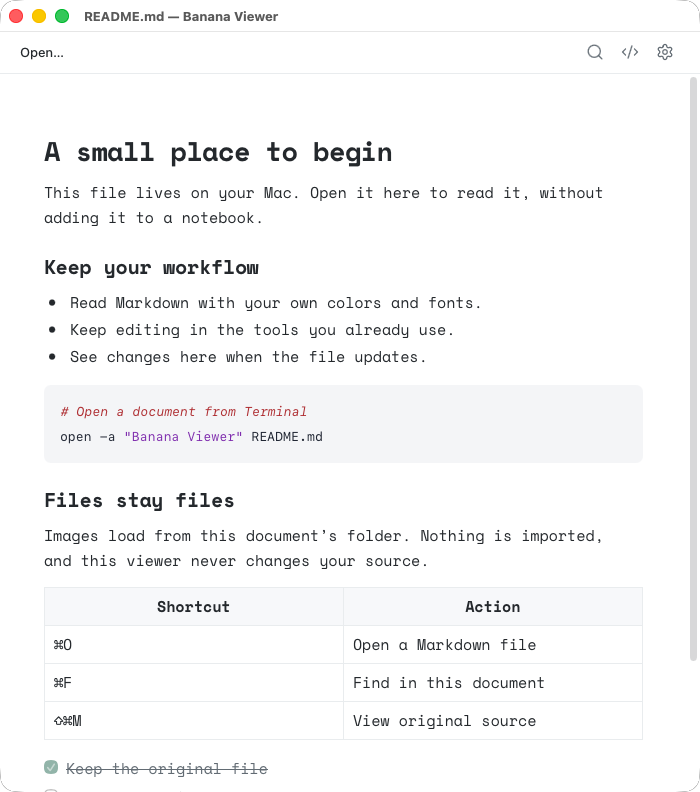

# Banana Viewer

<picture>
  <source media="(prefers-color-scheme: dark)" srcset="../assets/viewer-brand/logo-dark.svg">
  
</picture>

Banana Viewer is a separately installed macOS app for reading and editing Markdown files. It uses Banana Notes’ Markdown components, theme catalog, syntax colors, and bundled fonts without starting the notes runtime or opening its library.



The native app, opened through macOS with a synthetic Markdown file.

[Watch the 51-second narrated launch film](media/banana-viewer-launch.mp4) · [Poster](media/banana-viewer-launch-poster.png). It features ElevenLabs narration and music, with real Banana Viewer captures using synthetic sample documents.

## Build and run

Requires macOS 14+, the Xcode command-line tools, and Node.js 22+.

```sh
npm ci --ignore-scripts
npm run build:viewer
open "build/Banana Viewer.app"
open -a "$PWD/build/Banana Viewer.app" "$PWD/README.md"
```

The companion version is independently recorded in `viewer/version.txt`; `VIEWER_VERSION` and `VIEWER_BUILD` optionally override local build metadata. The build produces a universal Apple silicon/Intel application with its own document-line banana icon. Local builds are ad-hoc signed, not notarized distribution releases. The [independent Viewer release workflow](viewer-releases.md) prepares signed, notarized drafts under `viewer-v…` tags without replacing Banana Notes downloads or its update feed.

To install the companion, copy `build/Banana Viewer.app` into Applications. Banana Notes does not need to be installed. To make Viewer the default for Markdown, open Settings (⌘,) → **General** and turn on **Open Markdown files with Banana Viewer**. The switch remembers the previous default app in Viewer’s own preferences so it can restore that app when turned off. If Viewer was already the default, or no previous app could be remembered, use Finder: select a `.md` file and choose **Get Info → Open with → Change All**. The app does not change file associations automatically.

## Reading files

Use **File → Open…** (⌘O), Finder’s **Open With**, or the Terminal command above. Each file has its own ordinary Mac window; opening the same file again brings its existing window forward. Closing a window does not quit Banana Notes or affect its floating panel.

- Every document opens **locked**: rendered Markdown has no caret, task checkboxes are inert, and links open with one click. Lock state is per window and is never saved as a preference.
- Click the lock button or choose **Edit → Unlock to Edit** (⌘E) to edit in place. Rich editing keeps the current page and scroll position; task checkboxes work, and links open with ⌘-click. If rich editing cannot faithfully represent a document, Viewer opens its editable Markdown source instead with a brief notice.
- In source view (⇧⌘M), unlocking makes the original Markdown directly editable.
- Save explicitly with **File → Save** (⌘S). Viewer never autosaves. Dirty windows show the native edited dot and “— Edited” in the title; locking or closing asks whether to Save, Don’t Save, or Cancel. Opening Settings while unlocked keeps the document unlocked and preserves its in-memory edits when you return.
- If a dirty document changes on disk, Viewer pauses reload and offers **Reload** (discard edits) or **Keep My Edits**. Saving after keeping edits asks once before replacing the on-disk version.
- Use Find (⌘F) to search the current document, Reload (⌘R) to refresh, or let a locked or clean window detect external changes.
- Change text size with ⌘+, ⌘−, or ⌘0.

Viewer writes only after an explicit Save from an unlocked, dirty native window. Rich saves patch changed line hunks into the original file, retaining untouched source lines, line endings, final-newline state, and UTF-8 encoding. Source-mode saves write the exact text shown in the source editor. Files are not imported, moved, or deleted. Browser preview editing is unavailable.

Relative raster images resolve inside the document’s folder, including nested folders. Parent traversal, symlink escapes, arbitrary filesystem images, and remote image downloads are blocked. External web links open only after an explicit click. Keep images beside the document rather than linking to files outside its folder. In the browser preview, local image access is limited by the browser’s file picker; the native app is the full file-viewing experience.

## Independent appearance

Settings (⌘,) belongs to Banana Viewer:

- **General:** choose whether Markdown files open in Banana Viewer; when available, turning the switch off restores the previous app.
- **Appearance:** system-following appearance, the shared theme catalog, and independently chosen code colors.
- **Text:** built-in and bundled font families, supported weights, and text size.
- **Window:** focused/inactive opacity and background translucency. Reduced opacity also fades text and may reduce legibility.

Viewer preferences use its own `com.jzlosman.banana-viewer` identity. There is no shared configuration file, preference migration, or connection to the Banana Notes library. Font downloads are not included in this version.

## Architecture and safety

The bounded context is an external file document, not a library note. The source file is authoritative. The native file adapter owns bounded reads, change detection, and document-scoped resource access; deterministic policies validate file types, preferences, and allowed resources. The application composes these capabilities independently of the notes application.

The web composition root is `web/src/viewer/main.ts`; the native companion lives in `viewer/native/`. Shared components retain their existing defaults for Banana Notes. Document content is untrusted: it cannot execute arbitrary HTML/scripts, invoke native bridge actions, or silently start network requests. Preference and default-app status queries are separate from state-changing commands. Native document writes are available only through the bundled viewer's main-frame bridge, require an unlocked window and the expected on-disk revision, enforce the document-root and 8 MB limits, and atomically replace the canonical file while preserving POSIX permissions. Browser preview models writes as unavailable. LaunchServices is queried for the Markdown UTI and any distinct `.md` content type, and changes only after the explicit General switch action. The previous app bundle identifier is stored in Viewer preferences; the switch cannot turn off when no restorable previous app is available. Status exposes app display names, never paths. A different Banana Viewer copy counts as the default when its bundle identifier matches, regardless of where it is installed.

The normal `npm run build` still builds Banana Notes. `npm run build:viewer` builds the companion. Both use the shared web asset/font/license pipeline. Generated application bundles remain under ignored `build/`.

## Verification

```sh
npm run typecheck
npm test
npm run build:web
bash scripts/native-tests.sh
npm run test:viewer:native
bash scripts/build-app.sh
bash scripts/build-viewer.sh
npm run test:viewer:webkit
```

The WebKit smoke test exercises the native app with synthetic files and isolated preferences; it requires a local macOS graphical session. The [off](media/banana-viewer-default-off.png), [pending](media/banana-viewer-default-pending.png), and [on](media/banana-viewer-default-on.png) switch screenshots use the smoke test's fake Launch Services adapter and Preview sample status; they do not change this Mac's Markdown default. The other native tests cover file boundaries and preferences without opening the app.

Use synthetic Markdown files for document tests. Never substitute a personal Banana Notes library. The browser preview is at `http://127.0.0.1:4177/viewer.html` after `npm run dev`; its file picker and appearance preferences are independent of the Banana Notes browser preview.
